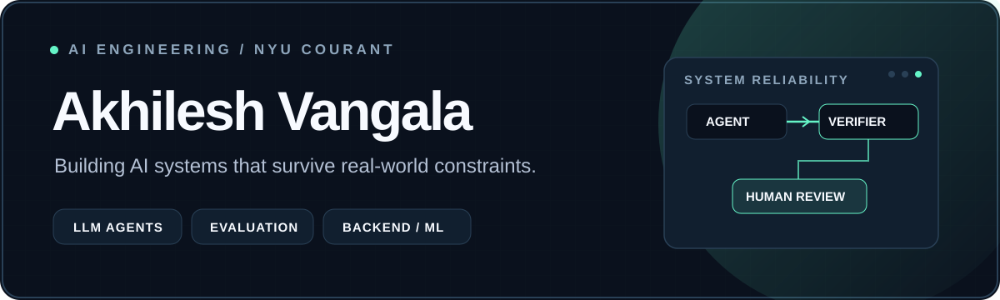
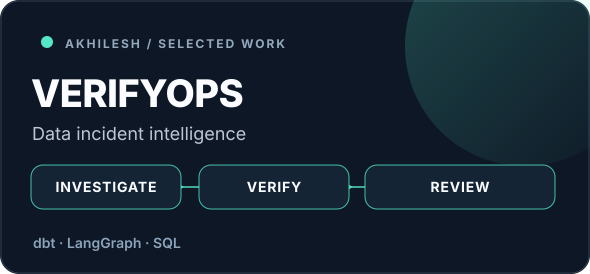
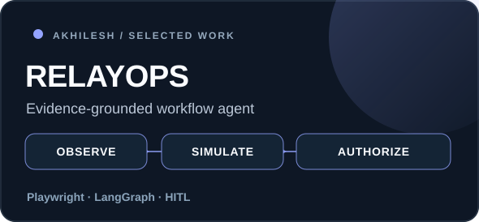
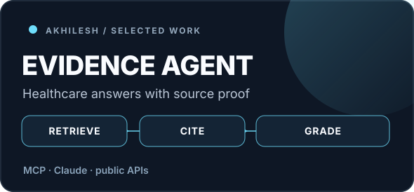
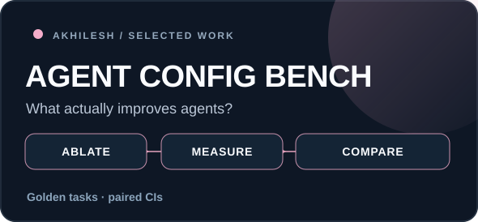
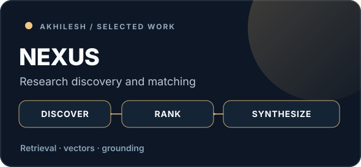
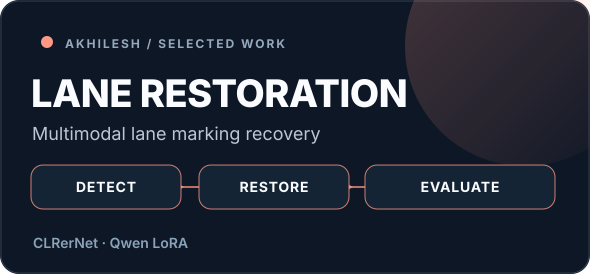

<picture>
  <source media="(prefers-color-scheme: light)" srcset="./assets/hero-light.svg" />
  
</picture>

**AI Engineer · Agentic Systems · Applied GenAI · Backend / ML Engineering**

[Portfolio](https://akhilesh-vangala.github.io/) &nbsp;·&nbsp; [LinkedIn](https://www.linkedin.com/in/akhilesh-nyu) &nbsp;·&nbsp; [Email](mailto:sv3129@nyu.edu) &nbsp;·&nbsp; [Repositories](https://github.com/Akhilesh-Vangala?tab=repositories)

I build **evidence-grounded AI systems**: agents that use tools, maintain auditable state, evaluate their outputs, and separate model proposals from verified actions. I'm pursuing an **M.S. in Data Science at NYU Courant (2027)**.

I work across **LLM applications, model evaluation, Python backends, ML systems, and applied research**. My current focus is building reliable agent workflows beyond polished demos.

## Selected systems

<table>
<tr>
<td width="50%" valign="top">
  
  <h3><a href="https://github.com/Akhilesh-Vangala/verifyops">VerifyOps</a></h3>
  
Agentic analytics incident investigation with restricted SQL, independent dbt repair checks, persistent work state and exact-version human review.

  
<code>LangGraph</code> <code>FastAPI</code> <code>DuckDB</code> <code>dbt</code>

  <a href="https://verifyops.vercel.app">Read-only product showcase</a> · <a href="https://github.com/Akhilesh-Vangala/verifyops/blob/main/docs/CASE-STUDY.md">Engineering case study</a>
</td>
<td width="50%" valign="top">
  
  <h3><a href="https://github.com/Akhilesh-Vangala/relayops">RelayOps</a></h3>
  
A bounded enterprise workflow agent with browser observations, cited hypotheses, private-copy simulation, immutable review, and receipted sandbox actions.

  
<code>LangGraph</code> <code>Playwright</code> <code>FastAPI</code> <code>Pydantic</code>

  <a href="https://relayops-two.vercel.app">Read-only product showcase</a> · <a href="https://github.com/Akhilesh-Vangala/relayops/blob/main/docs/CASE-STUDY.md">Engineering case study</a>
</td>
</tr>
<tr>
<td width="50%" valign="top">
  
  <h3><a href="https://github.com/Akhilesh-Vangala/healthcare-evidence-agent">Healthcare Evidence Agent</a></h3>
  
Claude Code + MCP tools + reusable skills for evidence-grounded questions using openFDA, ClinicalTrials.gov and CMS data. <strong>95% pass rate</strong> in the project's 30-task golden evaluation for the documented configuration.

  
<code>MCP</code> <code>Claude Code</code> <code>Agent Skills</code> <code>Evaluation</code>

  <a href="https://github.com/Akhilesh-Vangala/healthcare-evidence-agent">Results and reproducibility</a>
</td>
<td width="50%" valign="top">
  
  <h3><a href="https://github.com/Akhilesh-Vangala/agent-config-bench">Agent Config Bench</a></h3>
  
Controlled ablation study of tool access, agent skills and model choice, using identical tasks, an automatic grader, and task-paired bootstrap uncertainty estimates.

  
<code>Experiment Design</code> <code>Bootstrap CIs</code> <code>LLM Evaluation</code>

  <a href="https://github.com/Akhilesh-Vangala/agent-config-bench">Read the benchmark</a>
</td>
</tr>
<tr>
<td width="50%" valign="top">
  
  <h3><a href="https://github.com/Akhilesh-Vangala/Nexus">Nexus</a></h3>
  
Research advisor discovery using live retrieval, external research-activity checks, semantic matching and citation-grounded synthesis.

  
<code>TypeScript</code> <code>Retrieval</code> <code>Embeddings</code> <code>LLMs</code>

  <a href="https://github.com/Akhilesh-Vangala/Nexus">Explore the architecture</a>
</td>
<td width="50%" valign="top">
  
  <h3><a href="https://github.com/Akhilesh-Vangala/generative-lane-restoration">Generative Lane Restoration</a></h3>
  
Vision pipeline combining CLRerNet lane detection and LoRA fine-tuned Qwen Image Edit for restoring lane markings in dashcam frames.

  
<code>Computer Vision</code> <code>Fine-tuning</code> <code>PyTorch</code> <code>Qwen</code>

  <a href="https://github.com/Akhilesh-Vangala/generative-lane-restoration">View before/after examples</a>
</td>
</tr>
</table>

> **Scope note:** VerifyOps and RelayOps are development workbenches with read-only hosted showcases. Their documented demos use synthetic data / fixed or scripted diagnostic choices; live-model generalization and production integrations are not yet established.

## What I build with

| Area | Technologies / approaches |
| --- | --- |
| **Agent systems** | LangGraph, MCP, tool calling, retrieval, orchestration, structured outputs, human-in-the-loop controls |
| **Evaluation & reliability** | Golden datasets, executable graders, source-grounded citations, bootstrap comparisons, guardrails, failure analysis |
| **ML & research** | PyTorch, scikit-learn, fine-tuning / LoRA, multimodal pipelines, active learning, optimization |
| **Backend & infrastructure** | Python, TypeScript, FastAPI, SQL, PostgreSQL, Docker, AWS, CI/CD, observability |

<b>More of the stack: languages, platforms and engineering practices</b>

Python · SQL · TypeScript · Java · C++ · R · Bash · React · Git · Linux · FastAPI · SQLAlchemy · PostgreSQL · BigQuery · Apache Spark · PyTorch · scikit-learn · LangGraph · MCP · RAG · prompt / tool interfaces · Docker · AWS Lambda · GitHub Actions · OpenTelemetry · dbt · DuckDB · model evaluation · uncertainty quantification · API design · HPC / GPU workflows.

## Additional engineering work

**Applied AI & agent tooling:** [QueryPilot](https://github.com/Akhilesh-Vangala/querypilot) (guardrailed NL-to-SQL and execution-accuracy evaluation) · [BioRoute](https://github.com/Akhilesh-Vangala/bioroute) (open-weight vs hosted router and calibration benchmark) · [CurateX MCP](https://github.com/Akhilesh-Vangala/curatex-mcp) (multisource content research and generation workflow).

**ML systems & optimization:** [ForecastOps](https://github.com/Akhilesh-Vangala/forecastops) (point-in-time forecasting and drift) · [LensPlan](https://github.com/Akhilesh-Vangala/lensplan) (MILP and heuristic baseline) · [PlantPulse](https://github.com/Akhilesh-Vangala/plantpulse) (impact-ranked operations exceptions).

**Research & coursework:** [WorldCoder](https://github.com/Akhilesh-Vangala/WorldCoder) (4D scene editing research prototype) · [Metrik AI](https://github.com/Akhilesh-Vangala/Metrik-AI) (energy forecasting / anomaly detection) · [Building Energy Prediction](https://github.com/Akhilesh-Vangala/Predicting_Building_Energy_Consumption) (controlled ML comparisons).

## Research and experience

- **NYU Rory Meyers / genomic statistics:** scalable association scans, mixed models, numerical validation and GPU-oriented work.
- **NYU Center for Data Science / ActiveSysID:** closed-loop experiment design for learning dynamical systems.
- **SAP America (via SDVS Technologies):** data integration and quality workflows across 15 business domains and 2.1M+ records.
- **Healthcare AI and backend engineering:** database-grounded LLM interfaces, Python APIs, evaluation and operational guardrails.

## Contact

I'm interested in **AI Engineer, Applied AI, ML Engineer and AI-focused software engineering** opportunities.

[Portfolio](https://akhilesh-vangala.github.io/) · [LinkedIn](https://www.linkedin.com/in/akhilesh-nyu) · [Email](mailto:sv3129@nyu.edu)
