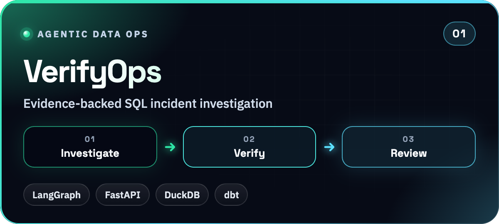
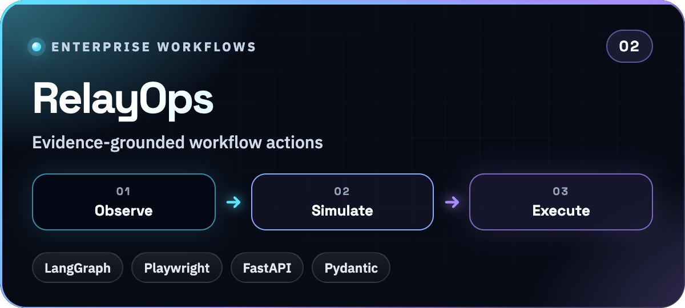
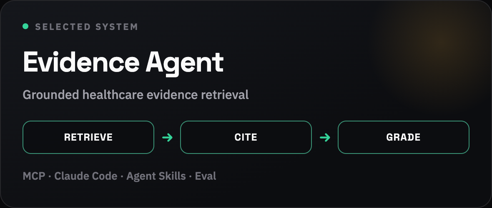
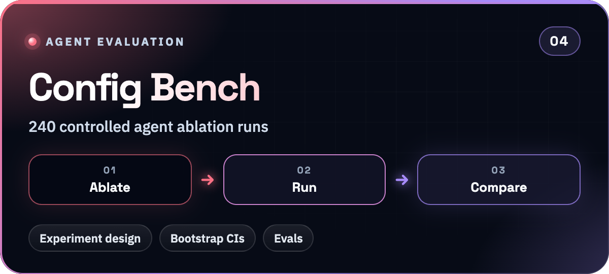
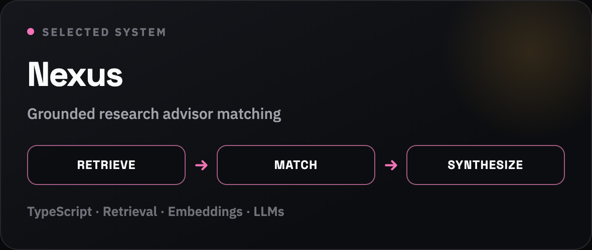
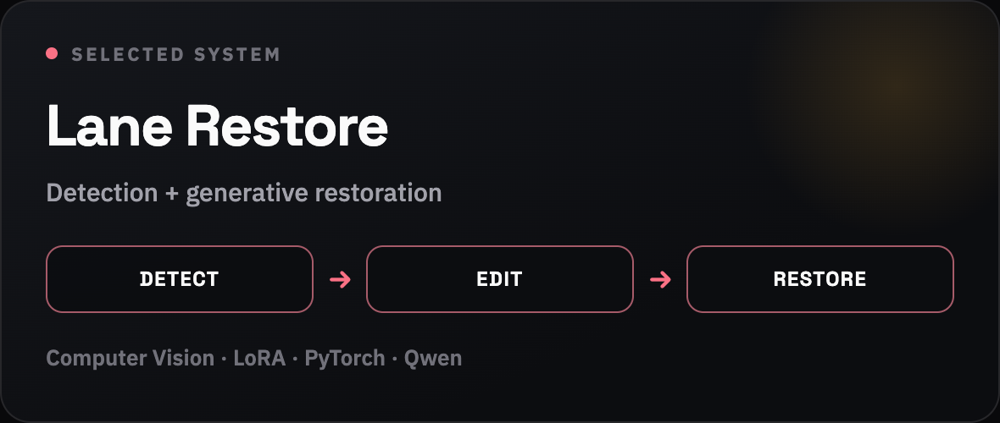

<picture>
  <source media="(prefers-color-scheme: light)" srcset="./assets/hero-light.png" />
  
</picture>

 

**AI Engineer** · Agentic Systems · Applied GenAI · Backend / ML  
MS Data Science @ New York University, Courant Institute of Mathematics, Computing, and Data Science  
New York City Metropolitan Area

I build **evidence-grounded agent systems**: tool-using workflows with auditable state, independent verification, golden-set evals, and human review before action. Focused on reliable LLM products, not demo-only pipelines.

## Skills

  

 

<table>
<tr>
<td width="22%" valign="top" align="center"><b>Languages</b></td>
<td>

</td>
</tr>
<tr>
<td width="22%" valign="top" align="center"><b>Agentic AI</b></td>
<td>

-2EAD33?style=for-the-badge)

</td>
</tr>
<tr>
<td width="22%" valign="top" align="center"><b>LLMs &amp; Retrieval</b></td>
<td>

-6950EF?style=for-the-badge&logo=qwen&logoColor=ffffff)

-7C3AED?style=for-the-badge)

</td>
</tr>
<tr>
<td width="22%" valign="top" align="center"><b>Evaluation &amp; Observability</b></td>
<td>

-0F766E?style=for-the-badge)

</td>
</tr>
<tr>
<td width="22%" valign="top" align="center"><b>ML &amp; Data Science</b></td>
<td>

</td>
</tr>
<tr>
<td width="22%" valign="top" align="center"><b>Production &amp; FDE</b></td>
<td>

</td>
</tr>
<tr>
<td width="22%" valign="top" align="center"><b>Data &amp; Platform</b></td>
<td>

</td>
</tr>
<tr>
<td width="22%" valign="top" align="center"><b>Frontend for AI products</b></td>
<td>

</td>
</tr>
</table>

---

## Selected systems

<table>
<tr>
<td width="50%" valign="top">
  
  
Restricted SQL investigation, independent dbt repair checks, persistent state, exact-version human review.

  
<a href="https://verifyops.vercel.app">Live showcase</a> · <a href="https://github.com/Akhilesh-Vangala/verifyops/blob/main/docs/CASE-STUDY.md">Case study</a>

</td>
<td width="50%" valign="top">
  
  
Browser observations, cited hypotheses, private-copy simulation, immutable review, receipted sandbox actions.

  
<a href="https://relayops-two.vercel.app">Live showcase</a> · <a href="https://github.com/Akhilesh-Vangala/relayops/blob/main/docs/CASE-STUDY.md">Case study</a>

</td>
</tr>
<tr>
<td width="50%" valign="top">
  
  
Claude Code + MCP + skills over openFDA, ClinicalTrials.gov, CMS. <strong>95%</strong> pass on a 30-task golden eval.

  
<a href="https://github.com/Akhilesh-Vangala/healthcare-evidence-agent">Results &amp; reproducibility</a>

</td>
<td width="50%" valign="top">
  
  
Ablation of tools, skills, and model choice with an automatic grader and paired bootstrap CIs.

  
<a href="https://github.com/Akhilesh-Vangala/agent-config-bench">Read the benchmark</a>

</td>
</tr>
<tr>
<td width="50%" valign="top">
  
  
Research advisor discovery with live retrieval, semantic matching, and citation-grounded synthesis.

  
<a href="https://github.com/Akhilesh-Vangala/Nexus">Architecture</a>

</td>
<td width="50%" valign="top">
  
  
CLRerNet detection + LoRA-tuned Qwen Image Edit for dashcam lane restoration.

  
<a href="https://github.com/Akhilesh-Vangala/generative-lane-restoration">Before / after</a>

</td>
</tr>
</table>

> **Scope:** VerifyOps and RelayOps are development workbenches with read-only showcases. Documented demos use synthetic data or scripted diagnostics. Live-model generalization and production connectors are not claimed yet.

## Experience

<table>
<tr>
<td width="34%" valign="top"><b>AI/ML Engineer (Capstone)</b> Sep 2026 - Present · New York, NY</td>
<td valign="top"><b>NYU Center for Data Science</b> 
Building <b>ActiveSysID</b>, a closed-loop active learning pipeline for dynamical systems using latent neural dynamics models and ensemble uncertainty to select the most informative experiments.</td>
</tr>
<tr>
<td valign="top"><b>AI/ML Engineer - Graduate Research Assistant</b> May 2026 - Present · Hybrid</td>
<td valign="top"><b>NYU Rory Meyers College of Nursing</b> 
NIH Alzheimer's Genomic Sequencing Project: developing scalable IBD-based association testing; extending to binary and survival outcomes with large-scale simulation and HPC validation.</td>
</tr>
<tr>
<td valign="top"><b>AI Web Developer</b> Jul 2026 - Sep 2026 · Hybrid</td>
<td valign="top"><b>New York University, Courant Institute of Mathematics, Computing, and Data Science</b> 
Shipped UI, research layouts, and interactive components for the <a href="https://cims.nyu.edu/dynamic/">NYU Courant AI website</a>; used LLM-assisted workflows to improve accessibility of AI research content.</td>
</tr>
<tr>
<td valign="top"><b>AI/ML Engineer Intern</b> Jun 2026 - Aug 2026 · Dallas, TX</td>
<td valign="top"><b>SAP Americas</b> (via SDVS Technologies) 
Built Python/SQL ETL and validation for SAP S/4HANA across 15 domains, 149 schemas, and <b>2.1M+</b> records. Applied LLM-assisted mapping, documentation, and test generation with the SAP Data Engineering team.</td>
</tr>
<tr>
<td valign="top"><b>AI/ML Engineer - Graduate Research Assistant</b> Feb 2026 - May 2026 · On-site</td>
<td valign="top"><b>Hochwagen Lab, NYU</b> 
Built NIH All of Us genomic pipelines across <b>200K+</b> samples and <b>20+</b> disease cohorts in Python, SQL, and BigQuery; feature engineering, predictive modeling, and automated QC.</td>
</tr>
<tr>
<td valign="top"><b>AI/ML Engineer</b> Aug 2024 - Aug 2025 · Hyderabad</td>
<td valign="top"><b>Virinchi Hospitals</b> 
Built GPT-4/GPT-4o tool-calling and RAG agents for hospital operations, billing, and reporting (Azure OpenAI, LangChain, FastAPI, read-only HIS SQL), with golden-set evals and mandatory human review on clinical outputs.</td>
</tr>
<tr>
<td valign="top"><b>AI Software Engineer Intern</b> May 2024 - Jul 2024 · Remote</td>
<td valign="top"><b>Dascase Technologies</b> 
Shipped production Python/FastAPI and AWS Lambda APIs with SQL backends and LLM-assisted retrieval; <b>99.5%</b> request success and p95 latency cut from <b>850ms to 320ms</b>.</td>
</tr>
</table>

---

## Also shipping

[QueryPilot](https://github.com/Akhilesh-Vangala/querypilot) · [Agent Router Bench](https://github.com/Akhilesh-Vangala/bioroute) · [CurateX MCP](https://github.com/Akhilesh-Vangala/curatex-mcp) · [ForecastOps](https://github.com/Akhilesh-Vangala/forecastops) · [LensPlan](https://github.com/Akhilesh-Vangala/lensplan) · [PlantPulse](https://github.com/Akhilesh-Vangala/plantpulse)

## Education

**M.S. Data Science**, New York University, Courant Institute of Mathematics, Computing, and Data Science · Sept 2025 - May 2027  
**B.Tech CSE (AI & ML)**, GITAM University · 2021 - 2025

## Contact

Happy to talk about **agent platforms**, **RAG systems**, and **evaluation-heavy AI products**.

[Portfolio](https://akhilesh-vangala.github.io/) · [LinkedIn](https://www.linkedin.com/in/akhilesh-nyu) · **sv3129@nyu.edu** · **sai.akhilesh.vangala@gmail.com**
